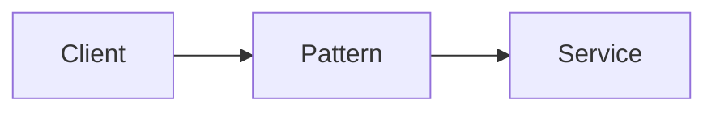

# <Pattern> Cheatsheet

> **One-line pitch:** the problem it solves and the core idea, in one sentence.

| | |
|---|---|
| **Type** | Pattern |
| **Level** | Beginner · Intermediate · Advanced |
| **Context** | e.g. `DDD`, `distributed systems` |
| **Last updated** | YYYY-MM-DD |
| **Tags** | `tag1` `tag2` |

---

## TL;DR

- **Problem:** …
- **Solution:** …
- **When:** …
- **Remember:** the single thing to retain.

---

## Mental model

Think of it as **…**. Instead of …, you …



---

## Structure

| Component | Responsibility |
|-----------|----------------|
| **A** | … |
| **B** | … |

---

## Example

```python
def example():
    ...
```

---

## Trade-offs

| Pros | Cons |
|--------|---------|
| … | … |

**Use when:** …

**Avoid when:** …

---

## Gotchas & common mistakes

- **Avoid:** Mistake → **Do:** do this instead

---

## See also

- [Related pattern](../patterns/other)
- [Reference](https://example.com)
